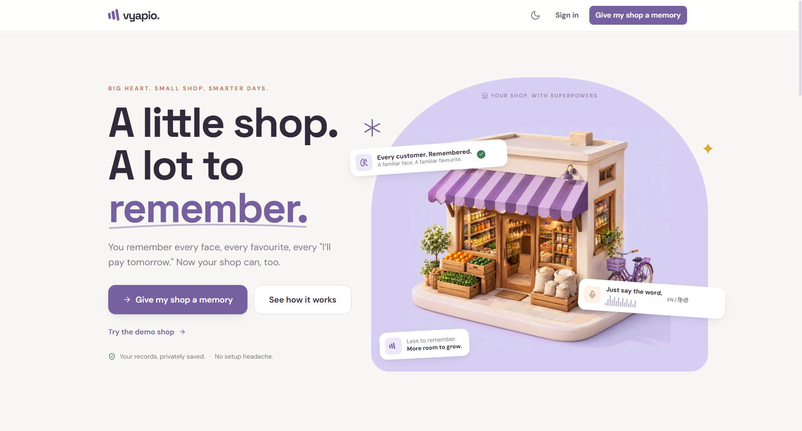
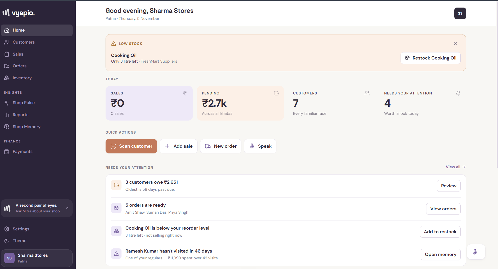

# Vyapio

**Your shop. Your memory. Your AI.**

Vyapio is an AI memory for neighbourhood shops (kirana stores). The shopkeeper
just speaks a sale, and Vyapio writes it down, remembers every customer,
tracks who owes money, and keeps working even without internet.

<p align="center">
  
</p>

## Watch the demo

[](https://youtu.be/7jA1bwqsQE8)

*3-minute walkthrough: speaking a sale in Hindi, customer memory, the AI confirmation rule and offline sync.*

---

## The problem

Small shopkeepers still run their business from memory and a paper khata. They
forget who owes money, what is running out, and what regulars usually buy.
Most apps need long forms, English, and good internet. Vyapio works the way a
shop really works: you talk, it remembers, and it keeps going when the network drops.

## What it can do

- **Speak a sale.** Say *"Ramesh ko 2 kilo chawal diya. 300 UPI kiya aur 120 baaki hai."* Vyapio makes a bill, and the shopkeeper confirms before anything is saved.
- **Remember every customer.** Visits, payments and promises as a timeline. A QR code opens a customer instantly.
- **Show what needs attention.** Low stock, overdue money and ready orders, every day.
- **Answer questions about the shop.** For example, "Who bought rice and oil together?", with the real receipts shown as proof.
- **Draft reminders with AI.** It can write them but never send one until a human taps Confirm.
- **Work offline.** Sales are saved on the phone and synced later.
- **Speak 7 languages.** English, Hindi, Bengali, Tamil, Telugu, Marathi, Kannada.

<p align="center">
  
</p>

---

## How it works

```
          Shopkeeper app          Customer app
                    └──────┬──────┘
                    React + Vite + Tailwind
                           │
                    Amazon Cognito            (login)
                           │
                     API Gateway (HTTP)       (front door)
                           │
              ┌────────────────────────┐
              │  ONE Lambda (Docker)   │      (the backend)
              └───────────┬────────────┘
       ┌──────────────────┼──────────────────┐
   DynamoDB              S3               Bedrock
   (database)         (files)             (AI)
```

The app runs in the browser and logs in through Cognito. Requests go through
API Gateway to one backend function on AWS Lambda, which uses DynamoDB (data),
S3 (files) and Bedrock (AI). There is no server to manage, and everything is
created from code with AWS CDK.

**A sale in 5 steps:** speak → speech becomes text → AI understands it → draft
bill is shown → shopkeeper confirms → saved.

More detail: [docs/ARCHITECTURE.md](docs/ARCHITECTURE.md)

## Built with

React, TypeScript, Vite, Tailwind CSS · Node.js, Zod · AWS Lambda, API Gateway,
DynamoDB, Cognito, S3, Bedrock, Transcribe, Textract, EventBridge, SNS,
Amplify · AWS CDK · 429 automated tests

## Engineering highlights

- **AI cannot act on its own.** A human must tap Confirm before anything is saved or sent. Tests enforce this.
- **One shop never sees another shop's data.** Tests try to break this from every angle.
- **Offline-first.** Sync with conflict handling, and honest status ("waiting to sync" until the server confirms).
- **One data definition** shared by frontend and backend, so a mismatch breaks the build, not production.
- **Honest Local mode.** Without AWS the app runs fully on your computer and says so on every screen.

---

## Try it

**Online:** <https://main.d2gujibx6ttp7w.amplifyapp.com> and press **Try the demo shop**.

> This runs on free AWS credits and may be turned off. If it does not open,
> watch the video above or run it locally below.

**On your computer (no AWS account needed):**

```bash
docker compose up        # then open http://localhost:8080
```

or

```bash
npm install
npm run seed             # builds the demo shop
npm run dev              # app on http://localhost:5173
```

Demo login: `demo@vyapio.app` / `VyapioDemo#2024`

## More docs

[Architecture](docs/ARCHITECTURE.md) · [AWS setup](docs/AWS_SETUP.md) · [Demo script](docs/DEMO.md) · [Security](docs/SECURITY.md)

---

**Vyapio**  *My shop remembers for me.*
